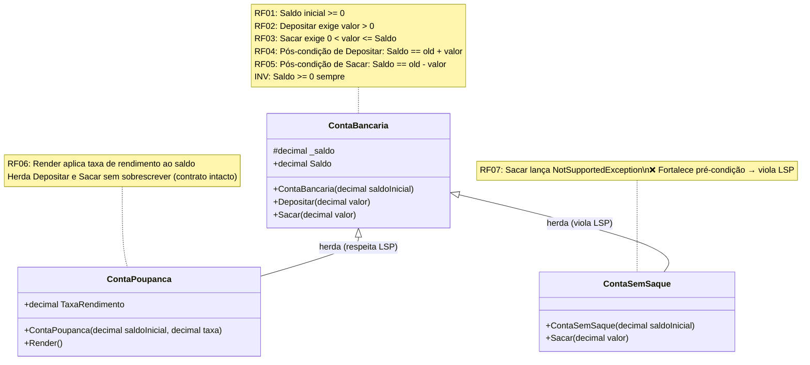

# LSP, Design by Contract e Herança Semântica em C#

Este repositório demonstra, com exemplos em **C#**, a relação entre o **Princípio da Substituição de Liskov (LSP)** — o "L" do SOLID —, o conceito de **manter a semântica do comportamento definido pela classe base** e como o **Design by Contract (DbC)** torna esse contrato comportamental **explícito e verificável**.

---

## 1. LSP e a semântica do comportamento da classe base

O **Princípio da Substituição de Liskov (LSP)** estabelece que:

> Objetos de uma subclasse devem poder substituir objetos da classe base **sem alterar a corretude** do programa.

Na prática, isso significa que a subclasse pode **reimplementar (sobrescrever)** métodos, mas o comportamento resultante deve continuar respeitando o **significado/contrato** original daquele método. Ou seja:

- **Não basta ter a mesma assinatura** (nome, parâmetros e tipo de retorno);
- É preciso preservar o **efeito esperado**: pré-condições, pós-condições e invariantes.

### O que "manter a semântica" exige

| Aspecto | Regra |
|---|---|
| **Pré-condições** | A subclasse **não pode exigir mais** do que a base (pode exigir menos). |
| **Pós-condições** | A subclasse **não pode garantir menos** do que a base (pode garantir mais). |
| **Invariantes** | Propriedades sempre verdadeiras na base devem continuar verdadeiras. |
| **Efeitos colaterais** | Devem ser compatíveis com o que o cliente da base espera. |
| **Exceções** | Não introduzir exceções novas/inesperadas que o cliente da base não saiba tratar. |

### Exemplo clássico de violação

```csharp
class Retangulo {
    protected int largura, altura;
    public virtual void SetLargura(int l) { largura = l; }
    public virtual void SetAltura(int a)  { altura = a; }
    public int Area() => largura * altura;
}

class Quadrado : Retangulo {
    public override void SetLargura(int l) { largura = altura = l; }
    public override void SetAltura(int a)  { largura = altura = a; }
}
```
Aqui o `Quadrado` **quebra a semântica** da classe base: quem usa um `Retangulo` espera poder alterar largura e altura independentemente. Ao substituir por um `Quadrado`, esse contrato é violado — clássica violação do LSP.

### Por que isso importa

Se a subclasse muda o **significado** do comportamento (mesmo mantendo a assinatura), o **polimorfismo quebra**: código escrito para a classe base passa a se comportar de forma inesperada quando recebe a subclasse. Isso destrói a confiabilidade da hierarquia.

> **Resumo**: Manter a semântica = a subclasse pode **especializar a implementação**, mas deve continuar **honrando o contrato comportamental** da classe base, de modo que um objeto da subclasse possa ser usado em qualquer lugar onde se espera um objeto da base, sem surpresas.

---

## 2. Design by Contract (DbC): tornando o contrato explícito e verificável

O **Design by Contract**, proposto por Bertrand Meyer, trata os métodos como um **contrato** entre o "provedor" (a classe) e o "cliente" (o chamador). O DbC é o **meio técnico** que torna o "contrato comportamental" do LSP **explícito e verificável**.

### Regras centrais na herança

- **Pré-condições só podem enfraquecer ou permanecer iguais**: a subclasse **não pode** exigir do cliente mais do que a classe base.
- **Pós-condições só podem fortalecer ou permanecer iguais**: a subclasse **não pode** prometer ao cliente menos do que a classe base.

> O DbC transforma a exigência semanticamente vaga do LSP em **verificações matemáticas de contrato**: se o método da subclasse segue as regras acima, então ele "mantém a semântica do comportamento da classe base" no nível do contrato.

### Exemplo em C#: contrato explícito com guard clauses

C# **não tem suporte nativo** a DbC como Eiffel (`require`/`ensure`/`invariant`). Na prática usamos **guard clauses + exceções** (ou `System.Diagnostics.Contracts` em .NET Framework legado).

#### Diagrama UML — Requisitos funcionais de exemplo de uma conta bancária



### Tabela de requisitos funcionais elicitados

| ID | Requisito funcional | Contrato associado |
|---|---|---|
| **RF01** | Criar conta com saldo inicial **não negativo** | Pré-condição do construtor |
| **RF02** | Depositar apenas valores **positivos** | Pré-condição de `Depositar` |
| **RF03** | Sacar apenas valores **positivos e ≤ saldo** | Pré-condição de `Sacar` |
| **RF04** | Após depósito, `Saldo == old(Saldo) + valor` | Pós-condição de `Depositar` |
| **RF05** | Após saque, `Saldo == old(Saldo) - valor` | Pós-condição de `Sacar` |
| **RF06** | Conta poupança aplica **taxa de rendimento** ao saldo | Método `Render` |
| **RF07** | Conta sem saque **não permite** saques | ⚠️ Violação de LSP (documentada para contraste) |
| **INV** | O saldo **nunca** fica negativo | Invariante da classe |

---


```csharp
public class ContaBancaria
{
    protected decimal _saldo;

    public ContaBancaria(decimal saldoInicial)
    {
        // Pré-condição
        if (saldoInicial < 0)
            throw new ArgumentOutOfRangeException(nameof(saldoInicial),
                "Saldo inicial não pode ser negativo.");
        _saldo = saldoInicial;
    }

    public decimal Saldo => _saldo;

    /// <summary>
    /// CONTRATO:
    /// Pré-condição : valor > 0
    /// Pós-condição : Saldo == old(Saldo) + valor
    /// Exceções     : ArgumentOutOfRangeException se valor <= 0
    /// </summary>
    public virtual void Depositar(decimal valor)
    {
        if (valor <= 0)
            throw new ArgumentOutOfRangeException(nameof(valor),
                "Depósito deve ser positivo.");

        var saldoAntigo = _saldo;
        _saldo += valor;

        // Pós-condição
        if (_saldo != saldoAntigo + valor)
            throw new InvalidOperationException("Pós-condição violada em Depositar.");
    }
  /// <summary>
    /// CONTRATO:
    /// Pré-condição : valor > 0 E valor <= Saldo
    /// Pós-condição : Saldo == old(Saldo) - valor
    /// </summary>
    public virtual void Sacar(decimal valor)
    {
        if (valor <= 0)
            throw new ArgumentOutOfRangeException(nameof(valor),
                "Saque deve ser positivo.");
        if (valor > _saldo)
            throw new InvalidOperationException("Saldo insuficiente.");

        var saldoAntigo = _saldo;
        _saldo -= valor;

        if (_saldo != saldoAntigo - valor)
            throw new InvalidOperationException("Pós-condição violada em Sacar.");
    }
}
```
### Subclasse que respeita o contrato

```csharp
public class ContaPoupanca : ContaBancaria
{
    public decimal TaxaRendimento { get; }

    public ContaPoupanca(decimal saldoInicial, decimal taxa)
        : base(saldoInicial)
    {
        if (taxa < 0) throw new ArgumentOutOfRangeException(nameof(taxa));
        TaxaRendimento = taxa;
    }

    public void Render()
    {
        // Não sobrescreve Depositar/Sacar => herda o contrato intacto
        _saldo += _saldo * TaxaRendimento;
    }
}
```
### Subclasse que viola o contrato (para contraste)

```csharp
public class ContaSemSaque : ContaBancaria
{
    public ContaSemSaque(decimal saldoInicial) : base(saldoInicial) { }

    public override void Sacar(decimal valor)
    {
        // ❌ Pré-condição FORTALECIDA: antes bastava valor <= Saldo;
        // agora exige também que a conta permita saque.
        // Isso quebra o LSP.
        throw new NotSupportedException("Esta conta não permite saques.");
    }
}
```
A forma correta seria **não herdar** de `ContaBancaria` (usar composição) ou modelar a restrição na própria base (ex.: propriedade `PermiteSaque`).

### Como testar os contratos automaticamente (xUnit + FluentAssertions)

```csharp
[Fact]
public void Depositar_ComValorZero_DeveLancarArgumentOutOfRangeException()
{
    var conta = new ContaBancaria(100m);
    Action act = () => conta.Depositar(0m);
    act.Should().Throw<ArgumentOutOfRangeException>()
        .WithParameterName("valor")
        .WithMessage("*Depósito deve ser positivo*");
}

[Fact]
public void Depositar_ComValorValido_DeveAumentarSaldoCorretamente()
{
    var conta = new ContaBancaria(100m);
    var saldoAntes = conta.Saldo;
    conta.Depositar(50m);
    conta.Saldo.Should().Be(saldoAntes + 50m);
}
```

A suíte de testes verifica **pré-condições** (entradas inválidas lançam exceções), **pós-condições** (o estado resultante corresponde ao esperado), **invariantes** (`Saldo >= 0`) e **substituição segura (LSP)**.

> **Resumo da relação**: O DbC fornece um conjunto de regras de verificação para "manter a semântica da classe base" (pré-condições enfraquecem, pós-condições fortalecem). Ele só garante a consistência formal do contrato; se a própria classe base não definiu o contrato de forma suficientemente precisa, a subclasse ainda pode "passar na verificação" mas na prática quebrar a substituição.

---
## Estrutura do repositório

```
.
├── src/
│   └── ContaBancaria/
│       ├── ContaBancaria.cs
│       ├── ContaPoupanca.cs
│       └── ContaSemSaque.cs
├── tests/
│   └── ContaBancaria.Tests/
│       ├── ContaBancariaContractTests.cs
│       ├── ContaPoupancaContractTests.cs
│       └── ContaSemSaqueContractViolationTests.cs
└── README.md
```
## Como executar os testes

## Considerações importantes
Não confundir os testes com contrato em runtime: 
- Os testes verificam exemplos específicos;
- DbC (com guard clauses) verifica o contrato em toda execução.
- Ambos são complementares: os testes documentam e previnem regressões, enquanto as guard clauses garantem que violações sejam detectadas em produção .
- FluentAssertions e exceções: Por padrão, Throw<T>() aceita subclasses de T. Se quiser o tipo exato, use ThrowExactly<T>() .

```bash
dotnet test
```

## Referências

- **LSP** — Barbara Liskov, *Data Abstraction and Hierarchy* (1987).
- **Design by Contract** — Bertrand Meyer, *Object-Oriented Software Construction* (1997).
- **SOLID** — Robert C. Martin, *Clean Architecture* (2017).
- **xUnit** — https://xunit.net/
- **FluentAssertions** — https://fluentassertions.com/
